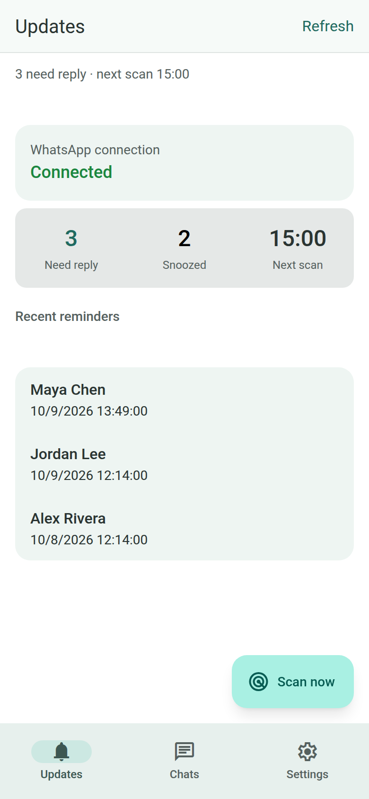
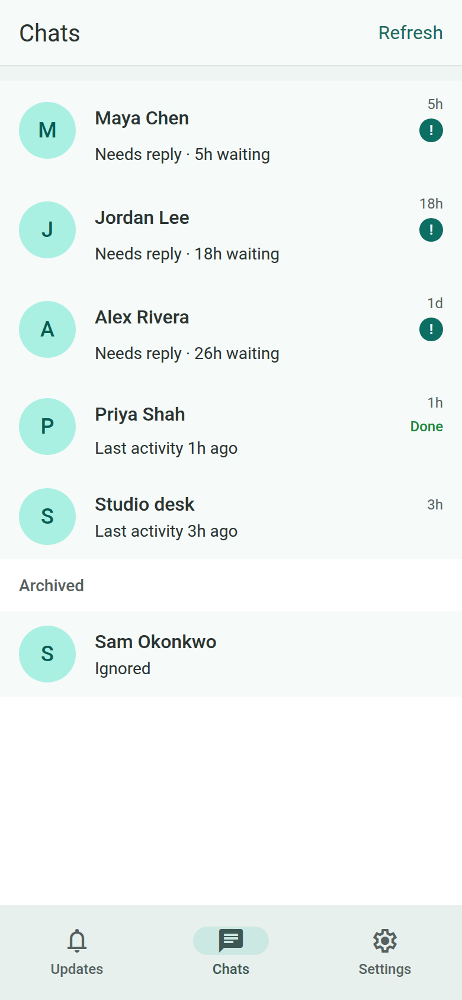
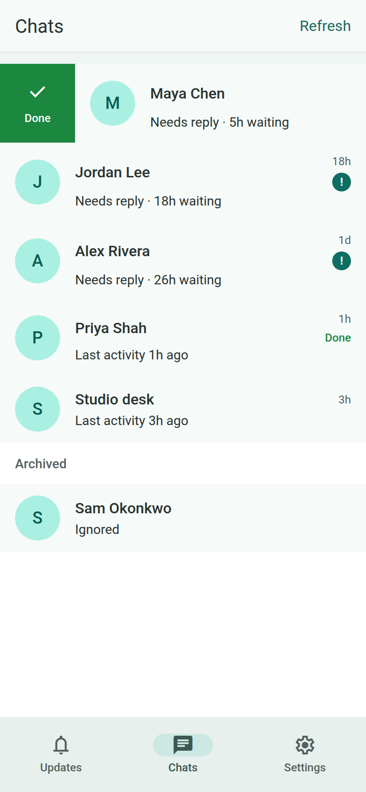
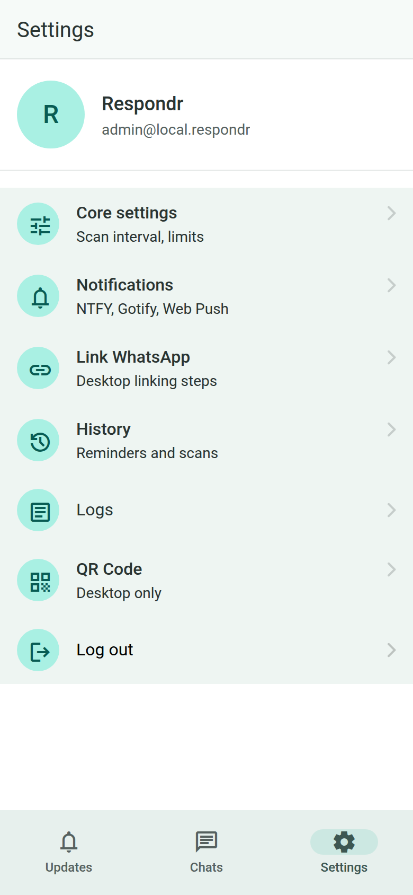
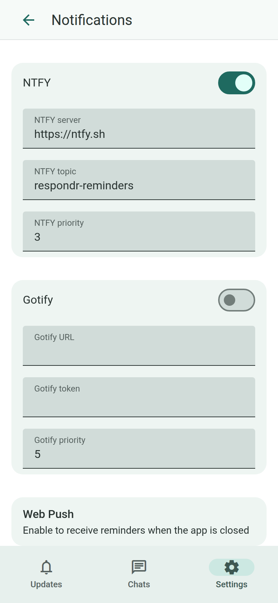
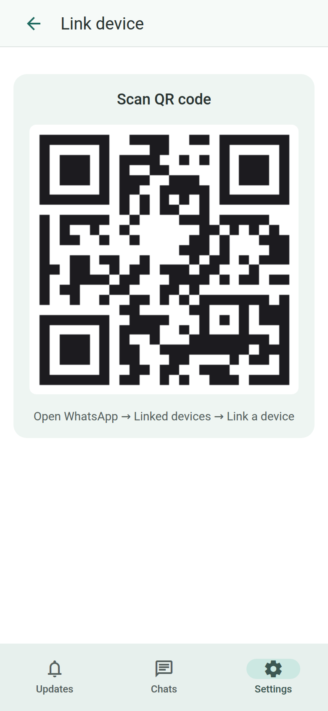

# Respondr — WhatsApp Response Reminder Engine

Respondr watches your personal WhatsApp chats and reminds you when someone is still waiting on a reply. It runs on a machine you control, links through WhatsApp's normal "linked devices" QR flow, and does not send messages back.

The dashboard is a SvelteKit PWA with a Material Design 3 layout (Konsta). After you sign in, three tabs cover the app: **Updates**, **Chats**, and **Settings**.

## Screenshots

These shots use sample conversations so the layout is visible without a live WhatsApp account. The QR image is a placeholder, not a pairing code. The app follows the device color scheme; the images below are the light theme.

<p align="center">
  
  
  
  
</p>
<p align="center">
  
  
</p>

---

## Key Features

* **Personal WhatsApp account:** Links as a companion device. No Meta Business API, registration, or verification fees.
* **Reply detection:** Flags a chat when the last message is from the contact and older than your threshold. A reaction you sent on that message counts as handled.
* **Narrow scan:** Skips groups, WhatsApp-archived threads, and muted chats. Only the most recent chats are checked, on a spaced interval.
* **Rules you can change in the app:** Scan interval (1–59 minutes), chat limit (1–200), and threshold (1–168 hours). Defaults are 30 minutes, 50 chats, and 3 hours. Saving them reschedules the scanner.
* **Link stay-alive:** Each scan sends a presence update so WhatsApp keeps the linked device active, and restarts the browser session if the connection has gone stale.
* **Chat actions:** Swipe right to mark a chat done (quiet until a newer message arrives). Swipe left to ignore it, which moves it to Archived inside Respondr. Swipe an archived chat to restore it.
* **Updates tab:** Connection status, how many chats need a reply, a snoozed count (done + ignored), the next scan time, recent reminders, and **Scan now**.
* **Notifications:** NTFY, Gotify, and Web Push. Turn them on in Settings and send a test from the notifications screen.
* **Installable PWA:** Add it to your home screen for Web Push. On iOS, push requires iOS 16.4+ and the app opened from the home screen, not Safari.
* **One admin:** Better Auth with public sign-up disabled. Create the account with `DASHBOARD_USER` / `DASHBOARD_PASSWORD`, or finish `/setup`.
* **Session persistence:** The WhatsApp session is stored locally, so you scan the QR code once.
* **Appearance:** Dark mode follows the system. Times use a 24-hour clock.

---

## How It Works

```text
[ Active WhatsApp Phone Session ]
                │ (Scanned via LocalAuth QR)
                ▼
  [ whatsapp-web.js (Puppeteer Instance) ]
                │
                ├──► 1. Sweeps top active chats on a cron schedule
                ├──► 2. Sends presence, then reads the latest message
                │
                ▼
        [ Conditional Filter ]
                │
                ├──► From you, or you reacted? ──► [ SKIP CHAT ]
                ├──► Group, archived, or muted? ──► [ SKIP CHAT ]
                ├──► Marked done or ignored? ────► [ SKIP CHAT ]
                └──► From the contact, older than the threshold
                             │
                             └──► [ NTFY / Gotify / Web Push ]
```

1. **Authentication:** The server starts a headless Chromium instance. On a computer, open **Settings → QR Code** (or `/qr`) and scan it from WhatsApp → Linked devices → Link a device. On a phone, **Settings → Link WhatsApp** lists those same steps.
2. **Analysis loop:** A cron scheduler sweeps the most recent chats. Each run also pings the session so the link stays up.
3. **Logic assessment:** If the contact sent the last message, you have not reacted to it, the chat is not done or ignored, and the message is older than the threshold, Respondr queues a reminder.
4. **Outbound notification:** The reminder goes out through whichever of NTFY, Gotify, and Web Push you enabled. Respondr does not send a WhatsApp message.

---

## Prerequisites

* **Docker** and **Docker Compose** — recommended for an always-on local server
* Or **Node.js** v22+ and **npm** for local development
* A dedicated **Chromium** install for WhatsApp Web (the Docker image includes this; local Node runs do not)

---

## Deploy on a local server

This is the supported way to run Respondr 24/7 on a machine you control (home Linux box, NAS with Docker, or a small VPS on your LAN). Docker Compose builds the image, runs Chromium, persists the WhatsApp session, and restarts the container after reboot.

Compose defaults `NODE_ENV` to `production` (override it only if you mean to). Production **will not start** with `http://192.168.x.x:9595`. Put TLS in front (Caddy, nginx, or Traefik) and set `BETTER_AUTH_URL` to that `https://` origin. Do not publish port 9595 to the public internet.

Full operator notes: [`docs/self-hosted-security.md`](docs/self-hosted-security.md).

### 1. Clone and configure

```bash
git clone https://github.com/FelixClements/Respondr.git
cd Respondr
cp .env.example .env
```

Generate secrets and edit `.env`:

```bash
openssl rand -base64 32   # BETTER_AUTH_SECRET
openssl rand -base64 24   # DASHBOARD_PASSWORD (or longer)
```

Minimum `.env` for Docker:

```env
BETTER_AUTH_URL=https://respondr.example.com
BETTER_AUTH_SECRET=<output of openssl rand -base64 32>
DASHBOARD_USER=admin
DASHBOARD_PASSWORD=<long random password>
TRUST_PROXY=true
```

`BETTER_AUTH_URL` must be the URL you type in the browser (scheme + host, no trailing path). Cookies and Better Auth break if this does not match.

Alternatively, set `SETUP_TOKEN` instead of `DASHBOARD_*` and complete `/setup` in the browser before opening the firewall. Generate it with `openssl rand -base64 32`.

### 2. TLS on the same host (Caddy)

Install [Caddy](https://caddyserver.com/docs/install), then reverse-proxy to the container. Bind Docker to loopback so only Caddy is reachable from the LAN.

Create `docker-compose.override.yml` next to `docker-compose.yml` (Compose merges it automatically; this repo gitignores it so `git pull` will not overwrite it):

```yaml
services:
  respondr:
    ports: !override
      - "127.0.0.1:9595:9595"
```

`!override` replaces the published `9595:9595` mapping instead of adding a second bind.

**Public hostname** (Let's Encrypt — home connection must allow ports 80/443, or use a tunnel):

```caddy
respondr.example.com {
    reverse_proxy 127.0.0.1:9595
}
```

**LAN-only hostname** (no public DNS). Add `192.168.x.x respondr.local` to `/etc/hosts` (or your LAN DNS) on every device that will open the dashboard, then:

```caddy
respondr.local {
    tls internal
    reverse_proxy 127.0.0.1:9595
}
```

Trust Caddy's local CA on those devices, or the browser will reject the certificate. Set `BETTER_AUTH_URL=https://respondr.local`.

If Caddy runs on a **different** machine, keep `9595:9595` and point `reverse_proxy` at the Respondr host. Still use HTTPS on the proxy; still set `BETTER_AUTH_URL` to the proxy's public `https://` URL.

### 3. Start the container

```bash
docker compose up -d --build
docker compose logs -f
```

`--build` compiles from this repo. That is the reliable local-server path. CI also publishes `ghcr.io/felixclements/respondr:latest`; Compose is tagged `respondr:local` and does not pull that image unless you change the `image:` line.

The container is healthy when logs show the Hono server listening and Better Auth migrations have finished. If startup exits immediately, it is usually a missing `BETTER_AUTH_SECRET`, a placeholder secret, or `BETTER_AUTH_URL` that is not `https://`.

### 4. Open the dashboard and link WhatsApp

1. Visit `https://respondr.example.com` (or your LAN hostname).
2. Sign in with `DASHBOARD_USER` / `DASHBOARD_PASSWORD` (or finish `/setup` if you used `SETUP_TOKEN`).
3. Open **Settings → QR Code** and scan it from WhatsApp on your phone (Linked devices → Link a device).
4. Keep the server running. The session is stored in the `respondr_wwebjs_auth` volume; the SQLite database is in `respondr_data`.

### 5. Day-to-day operations

```bash
docker compose logs -f                         # follow logs
docker compose restart                         # restart after .env edits
git pull && docker compose up -d --build       # update from git
docker compose down                            # stop (named volumes are kept)
```

Back up both Docker volumes (`respondr_data` and `respondr_wwebjs_auth`) before migrating hosts. Losing the auth volume means scanning the QR code again.

---

## Internet-facing deployment

Same Docker flow as above, plus:

* A real public hostname and TLS (do not expose port 9595 directly).
* `BETTER_AUTH_URL=https://your-public-hostname`
* `TRUST_PROXY=true` when a reverse proxy sits in front.
* Prefer VPN / Tailscale over opening the dashboard to the whole internet.

See [`docs/self-hosted-security.md`](docs/self-hosted-security.md) for the threat model and checklist.

---

## Environment Variables

| Variable | Description | Default |
|---|---|---|
| `NODE_ENV` | Runtime environment (`production` enforces HTTPS URL + secret checks). Compose forces `production`. | `development` |
| `PORT` | Web server port | `9595` |
| `HOST` | Listen address (`127.0.0.1` in development, `0.0.0.0` in production) | (see description) |
| `TRUST_PROXY` | Set `true` behind Caddy/nginx/Traefik so rate limits use `X-Forwarded-For` | (off) |
| `BETTER_AUTH_URL` | Public URL of the app (must be `https://` in production) | `http://localhost:9595` |
| `BETTER_AUTH_SECRET` | Auth signing secret (≥32 chars, required in production) | dev fallback in development only |
| `SETUP_TOKEN` | Token required for HTTP `/setup` when not bound to loopback (optional if using `DASHBOARD_*`) | (none) |
| `SCAN_INTERVAL_MINUTES` | Minutes between automatic scans | `30` |
| `CHAT_LIMIT` | Number of recent chats to check | `50` |
| `THRESHOLD_HOURS` | Hours before a chat is considered forgotten | `3` |
| `DASHBOARD_USER` | Bootstrap username on first run (if no users exist) | (none) |
| `DASHBOARD_PASSWORD` | Bootstrap password on first run | (none) |
| `NTFY_SERVER` | NTFY server URL | `https://ntfy.sh` |
| `NTFY_TOPIC` | NTFY topic to publish to | (none) |
| `NTFY_PRIORITY` | NTFY message priority | `3` |
| `GOTIFY_URL` | Gotify server URL | (none) |
| `GOTIFY_TOKEN` | Gotify app token | (none) |
| `GOTIFY_PRIORITY` | Gotify message priority | `5` |
| `VAPID_PUBLIC_KEY` | Web Push VAPID public key (see below) | (none) |
| `VAPID_PRIVATE_KEY` | Web Push VAPID private key | (none) |
| `VAPID_SUBJECT` | Contact URI for VAPID (`mailto:` or `https:`) | `mailto:respondr@example.com` |
| `PUPPETEER_EXECUTABLE_PATH` | Chromium binary. Docker sets `/usr/bin/chromium`. | macOS Chromium app if present |

### Web Push (PWA) setup

1. Generate VAPID keys:
   ```bash
   npx web-push generate-vapid-keys
   ```
2. Add the keys to `.env`:
   ```bash
   VAPID_PUBLIC_KEY=...
   VAPID_PRIVATE_KEY=...
   VAPID_SUBJECT=mailto:you@example.com
   ```
3. Install the Respondr PWA (Add to Home Screen on mobile).
4. Open **Settings → Notifications** and tap **Enable push notifications**.
5. Use **Test Web Push** to verify OS notifications arrive when the app is in the background.

On iOS, Web Push requires iOS 16.4+ and the app must be opened from the home screen (standalone mode), not Safari.

### NTFY setup

1. Install the NTFY app on your phone.
2. Pick a unique topic name, e.g. `respondr-alerts-yourname`.
3. Subscribe to that topic in the app.
4. Set `NTFY_TOPIC=respondr-alerts-yourname` in `.env`.

### Gotify setup

1. Run your own Gotify server (or use an existing one).
2. Create an app and copy the token.
3. Set `GOTIFY_URL` and `GOTIFY_TOKEN` in `.env`.

---

## Local development

Use this on a laptop while hacking on the code. It is not a production deploy: the server binds `127.0.0.1` unless you set `HOST`, and WhatsApp Web needs a local Chromium.

```bash
# Install dependencies
npm install
npm install --prefix web

# Configure environment
cp .env.example .env
# Set BETTER_AUTH_SECRET (openssl rand -base64 32) and optional DASHBOARD_USER/PASSWORD

# Run Better Auth migrations (first time)
npm run auth:migrate

# Development (Hono API + SvelteKit frontend with hot reload)
npm run dev

# Production-like local build (still needs https:// BETTER_AUTH_URL if NODE_ENV=production)
npm run build
npm start
```

The Hono server runs on port `9595` and serves the SvelteKit SPA from `web/build/`. During development, the Vite dev server proxies `/api` to Hono.

Set `PUPPETEER_EXECUTABLE_PATH` to a dedicated Chromium, not your personal Chrome:

* macOS: `/Applications/Chromium.app/Contents/MacOS/Chromium`
* Linux: `/usr/bin/chromium` or `/usr/bin/chromium-browser`

### Upgrading from pre-0.2.0

The dashboard was rebuilt as a SvelteKit SPA with Better Auth. After upgrading:

1. Run `npm run auth:migrate` to add auth tables to SQLite.
2. Set `BETTER_AUTH_SECRET` in `.env`.
3. Re-create your account via `/setup` or set `DASHBOARD_USER` / `DASHBOARD_PASSWORD` for auto-bootstrap.
4. Passwords must be at least 8 characters (was 6 in earlier versions).
5. You will need to log in again (session cookies changed).
6. Chats you ignored before 0.2.0 are not carried over; ignore them again from the Chats tab.

---

## Essential Safety Practices

Because WhatsApp explicitly states in its terms that it does not authorize unofficial third-party automation, using this method carries an account suspension risk. To safeguard your personal number:

* **Never use this script to send automated replies.** Only use it as a passive monitoring tool.
* **Keep scan intervals large** (30+ minutes). Aggressive polling flags anti-bot systems.
* **Limit the scope.** Focus on the top recent active chats instead of scraping thousands of threads.

---

## License

This project is open-source and available under the [MIT License](LICENSE).
